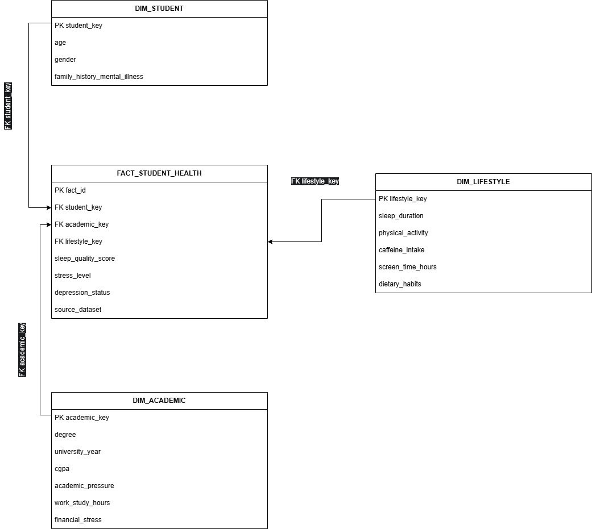

# Student Health and Well-Being Data Warehouse & Analytics

An end-to-end Data Integration and Data Warehousing project exploring the impacts of academic pressure, lifestyle habits, financial stress, and family history on student mental well-being and depression rates.

> Group project for the **DS2202 - Data Integration and Warehousing** course, Data Science Department, Umm Al-Qura University.

---

## Research Question
How do academic pressure, sleep quality, physical activity, and socio-economic factors (such as financial stress and family mental health history) interact to influence student stress levels and depression prevalence across different academic majors?

---

## Datasets & Integration
The project integrates 3 structured CSV datasets (Kaggle) and 1 unstructured text dataset:
- **Sleep Health & Lifestyle Dataset:** 400 records (CSV) — Sleep duration, quality, physical activity, stress, BMI, heart rate, sleep disorders.
- **Student Sleep Patterns Dataset:** 500 records (CSV) — Sleep habits, study hours, screen time, caffeine intake.
- **Student Depression Dataset:** ~1000 records (CSV) — Demographics, academic indicators, financial stress, depression status.
- **Teen Mental Health Chatbot:** Unstructured text — Free-form teen messages processed via Natural Language Processing (NLP) sentiment analysis to extract emotion labels.

---

## Data Pipeline & Preprocessing
Key data cleaning and integration steps executed prior to warehousing:
- **CGPA Validation:** Filtered out invalid records with CGPA < 1.0.
- **Age Scope:** Filtered non-student records (retained ages ≤ 30).
- **Format Parsing:** Converted decimal times (e.g., `21.93` → `21:55`) and split blood pressure strings (`120/80` → systolic/diastolic).
- **Imputation:** Filled missing stress data using mode values; assigned `'None'` to missing sleep disorder fields.
- **Schema Matching & Mapping:** Resolved attribute correspondences (1:1 direct transfers and conditional mappings) to unify heterogeneous source schemas into a cohesive structure.

---

## Data Warehouse Architecture (Star Schema)

---

## OLAP & Strategic Visualizations

| # | Chart Type | Analytical Focus | Core Finding / Insights |
|---|------------|------------------|-------------------------|
| 1 | Bar Chart | Depression Rate by Degree | Health-related majors (Medicine, Nursing, Psychology) exhibited highest depression rates (up to 100% in sample), while Engineering and Business showed 0%. |
| 2 | Line Chart | Academic Pressure vs. Sleep Quality & Stress | Inverse relationship: At academic pressure level 5, average sleep quality dropped to 4.17/10 while stress peaked at 8.17/10. |
| 3 | Grouped Bar | Sleep & Physical Activity vs. Stress | Active students with adequate sleep (≥7h) reported 0% depression and lowest stress (3.17). Poor sleep (<7h) combined with inactivity led to highest stress (7.63). |
| 4 | Pivot Table | Financial Stress & Family History | High financial stress (levels 4–5) strongly predicts depression, reaching 100% prevalence when combined with a family history of mental illness. |

---

## Key Findings & Recommendations
- **High-Risk Academic Tracks:** Specialized mental health support programs should be prioritized for students enrolled in intense health-related majors.
- **Lifestyle Buffers:** Promoting sleep hygiene and regular physical activity serves as a powerful protective barrier against stress and depression.
- **Financial & Early Interventions:** Implementing university financial aid initiatives and deploying OLAP dashboards can help identify and support vulnerable students early.

---

## Tools & Technologies Used
- **Database & Data Warehouse:** MySQL Workbench / MySQL 8
- **Data Processing & Analytics:** Python (pandas, scikit-learn), SQL (OLAP Queries)
- **Data Visualization:** Tableau, Excel Dashboarding
- **Text Mining:** NLP Sentiment Analysis

---

## How to Run / Replicate
1. Load the dataset CSV files into your SQL environment.
2. Execute the DDL scripts to create the Star Schema (`DIM_STUDENT`, `DIM_ACADEMIC`, `DIM_LIFESTYLE`, `FACT_STUDENT_HEALTH`).
3. Run the ETL pipeline scripts to populate dimensions and fact tables.
4. Open the SQL OLAP script or visualization dashboards to explore query results.

---

## Team Members
- **Fay Salman Alzahrany** (ID: 44510217)
- **Retaj Khaled Alashqar** (ID: 446008786)
- **Bayan Bandar Almatrafi** (ID: 445009448)
